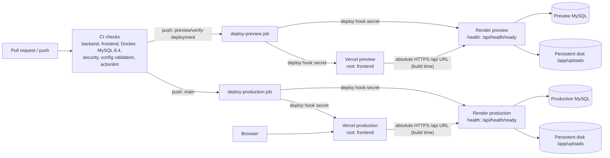

# AutoScientist AI — Deployment Guide

> **Status:** this document reflects the deployment configuration in this worktree.
> No real Render/Vercel deployment has been verified from here: provider settings,
> database state, deploy hooks, and health URLs must be checked manually by an
> authorized operator. See `release-readiness/CANONICAL_DEPLOYMENT_CHECKLIST.md`.

---

## Table of Contents

1. [Architecture overview](#1-architecture-overview)
2. [Storage and readiness](#2-storage-and-readiness)
3. [Provider configuration (names only)](#3-provider-configuration-names-only)
4. [GitHub Actions CI and gated deploys](#4-github-actions-ci-and-gated-deploys)
5. [Preview deployment procedure](#5-preview-deployment-procedure)
6. [Production deployment procedure](#6-production-deployment-procedure)
7. [Post-deployment verification](#7-post-deployment-verification)
8. [Rollback](#8-rollback)
9. [Environment variable reference](#9-environment-variable-reference)
10. [Security and local artifacts](#10-security-and-local-artifacts)
11. [Exact staging, commit and push commands](#11-exact-staging-commit-and-push-commands)
12. [Scope of this documentation pass](#12-scope-of-this-documentation-pass)

---

## 1. Architecture overview

| Layer | Technology | Host / source of truth |
|---|---|---|
| Frontend | React 18 + Vite, framework `vite`, `npm ci`, `npm run build`, output `dist` | Vercel; Root Directory `frontend` is a **dashboard** setting |
| Backend (preview) | Java 17 + Spring Boot 4 Docker image | Render service `autoscientist-backend-preview`, branch `preview/verify-deployment` |
| Backend (production) | Java 17 + Spring Boot 4 Docker image | Render service `autoscientist-backend-production`, branch `main` |
| Database | Managed MySQL (CI uses MySQL 8.4) | **Two separate databases** — one preview, one production; never shared |
| Dataset files | Local filesystem under `/app/uploads/datasets` | Persistent Render disk mounted at `/app/uploads` for each service |



`render.yaml` declares both backend services with `dockerContext: .`,
`dockerfilePath: ./Dockerfile`, `healthCheckPath: /api/health/ready`,
`autoDeployTrigger: off`, and separate disks. The only matched Docker
pairs are repository root context `.` with the root `Dockerfile`, or `backend`
context with `backend/Dockerfile`; never mix them. Provider Git auto-deploy is
off for `main` and `preview/verify-deployment` because CI owns those deploys.

## 2. Storage and readiness

Uploaded CSV/Excel files are written under `FILE_UPLOAD_DIR`
(`/app/uploads/datasets` in the container) with UUID filenames, while their
metadata lives in MySQL. `VOLUME ["/app/uploads"]` in both Dockerfiles does **not**
provision provider storage: a durable disk must be attached and mounted at
`/app/uploads` for **both** preview and production services, writable by uid 10001.

Ephemeral container storage is **not acceptable**. Without a persistent disk,
metadata survives a redeploy but the physical files do not, and features that
need the file (EDA, AutoML, Ask Dataset, drift, reports) fail with a "dataset file
is no longer available" error. Re-uploading is only a local workaround, not a
deployed configuration.

Health endpoints:

- `GET /api/health` — liveness. Returns `{"success":true,"data":{"status":"UP"}}`
  (the data map also includes `timestamp`).
- `GET /api/health/ready` — readiness; checks the datasource with `SELECT 1`,
  storage writability, and (when Flyway is enabled) that migrations are current.
  The payload contains `status`, `database`, `storage`, `migrations`, and
  `timestamp` under `data`. **There is no `storageBackend` field.** A failed
  dependency returns HTTP 503 with `success: false` and `status: DOWN`.
- Frontend health is the deployed root URL (`/`), not an API route.

`/actuator/info` is intentionally not public. The base actuator configuration
exposes `health,metrics,prometheus` only; do not rely on actuator endpoints for
deployment verification — use `/api/health` and `/api/health/ready`.

## 3. Provider configuration (names only)

### Backend (Render)

`render.yaml` sets `SPRING_PROFILES_ACTIVE=mysql`, `FILE_UPLOAD_DIR=/app/uploads/datasets`,
`SPRING_JPA_HIBERNATE_DDL_AUTO=validate`, `SPRING_FLYWAY_ENABLED=true`,
`RATE_LIMIT_ENABLED=true`, `ALLOW_PROXY_HEADERS=true`,
`FORWARD_HEADERS_STRATEGY=framework`, and `TRUSTED_PROXY_COUNT=1` as non-secret
values. Values for these keys must be supplied in the provider (many marked
`sync: false` in `render.yaml`): `SPRING_DATASOURCE_URL`,
`SPRING_DATASOURCE_USERNAME`, `SPRING_DATASOURCE_PASSWORD`, `JWT_SECRET`,
`APP_CORS_ALLOWED_ORIGINS`, `FRONTEND_URL`, plus optional `SPRING_MAIL_HOST`,
`SPRING_MAIL_PORT`, `SPRING_MAIL_USERNAME`, `SPRING_MAIL_PASSWORD`, and
`PASSWORD_RESET_FROM`. `SPRING_DATASOURCE_URL` must point at the service's own
managed database. Never put credentials in the repository.

Flyway owns the schema (V1–V7) with Hibernate `validate`. Do not run
`database/schema.sql` or use a root account against a deployed database. Take a
backup before any migration and verify `flyway_schema_history` afterwards.

### Frontend (Vercel)

Set in the dashboard: Root Directory `frontend`, Node version from
`^20.19.0 || ^22.13.0 || >=24.0.0` (CI pins 22.13.0), Install Command `npm ci`,
Build Command `npm run build`, Output Directory `dist`. `frontend/vercel.json`
declares framework `vite`, the SPA rewrite `/(.*)` → `/index.html`, and
`git.deploymentEnabled` `false` for `main` and `preview/verify-deployment`. Pull
branches remain enabled for Vercel preview comments.

For Production **and** Preview, set build-time `VITE_API_BASE_URL` to an absolute
HTTPS URL ending in `/api` (for example `https://<backend-origin>/api`). Never use
a localhost URL and never treat this value as a secret. Same-origin `/api` is
valid only if a real reverse proxy exists and `VITE_API_PROXY_MODE=same-origin`
is set; the Vercel SPA rewrite alone is not an API proxy. Vite bakes the URL into
`dist`, so a change requires a rebuild.

## 4. GitHub Actions CI and gated deploys

`.github/workflows/ci.yml` runs on pull requests targeting `main` or
`preview/verify-deployment`, and on pushes to those two branches. Every run
executes:

- Backend tests, `DeploymentProfileGuardTest`, packaging, and an assertion that
  Flyway V1–V7 are present in the JAR (Java 17).
- Frontend `npm ci`, lint, tests, `npm audit`, production build, and a check that
  no local API URL is baked into `dist` (Node 22.13.0).
- Docker builds for both matched Docker pairs.
- Real MySQL 8.4 migration and runtime smoke tests.
- Tracked secret/artifact scan and OSV dependency scan.
- `scripts/validate-deployment-config.sh` deployment-config validation.
- Workflow syntax validation with pinned actionlint 1.7.12.

Deploy jobs depend on **all** of these checks and are gated by event and branch:

| Job | Condition | Secrets | Variables |
|---|---|---|---|
| `deploy-preview` | push to `preview/verify-deployment` and `PREVIEW_DEPLOY_ENABLED == 'true'` | `RENDER_PREVIEW_DEPLOY_HOOK_URL`, `VERCEL_PREVIEW_DEPLOY_HOOK_URL` | `PREVIEW_BACKEND_HEALTH_URL`, `PREVIEW_FRONTEND_HEALTH_URL` |
| `deploy-production` | push to `main` and `PRODUCTION_DEPLOY_ENABLED == 'true'` | `RENDER_PRODUCTION_DEPLOY_HOOK_URL`, `VERCEL_PRODUCTION_DEPLOY_HOOK_URL` | `PRODUCTION_BACKEND_HEALTH_URL`, `PRODUCTION_FRONTEND_HEALTH_URL` |

This is how CI failures prevent deployment: a failed check means `needs` is not
satisfied and no deploy hook is called. A pull request never triggers a deploy
job. Health URLs are repository variables and each URL is polled up to 30 times
at 10-second intervals (about five minutes). Provider Git auto-deploy must stay off for `main`
and `preview/verify-deployment` to avoid duplicate deployments. Confirm the hook
targets and connected branches in the provider dashboards; they cannot be
verified from the repository.

## 5. Preview deployment procedure

1. Verify Java 17 locally before any Maven command (on macOS:
   `export JAVA_HOME="$(/usr/libexec/java_home -v 17)"`).
2. Run the local checks and stage/push only reviewed files to
   `preview/verify-deployment` (see §11).
3. Watch the CI run: all check jobs must pass. Any failure stops the deploy.
4. On a successful push, `deploy-preview` calls the Render and Vercel preview
   hooks and polls `PREVIEW_BACKEND_HEALTH_URL` and
   `PREVIEW_FRONTEND_HEALTH_URL`.
5. In the Render dashboard confirm the preview service is on
   `preview/verify-deployment`, uses the MySQL profile, has its own database and
   persistent disk at `/app/uploads`, and reports
   `GET /api/health/ready` as healthy.
6. In the Vercel dashboard confirm the Preview build used Root Directory
   `frontend` and a non-local HTTPS `VITE_API_BASE_URL` ending in `/api`.
7. Run the smoke checks in §7 against the preview URLs. Use throwaway data only.

## 6. Production deployment procedure

1. Keep `main` changes limited to commits already green on
   `preview/verify-deployment`; back up the production database and uploads.
2. Open a pull request from `preview/verify-deployment` to `main` and require all
   CI checks to pass. Pull requests do not deploy.
3. Merge into `main` and push the merge commit. Only a **push** to `main` with
   `PRODUCTION_DEPLOY_ENABLED == 'true'` triggers `deploy-production`.
4. The job calls the production deploy hooks and polls
   `PRODUCTION_BACKEND_HEALTH_URL` and `PRODUCTION_FRONTEND_HEALTH_URL`.
5. Confirm in the provider dashboards: service branch `main`, separate production
   MySQL database, durable disk at `/app/uploads`, health check path
   `/api/health/ready`, auto-deploy off, Vercel root `frontend`, and the intended
   build-time API URL for Production **and** Preview.
6. Run §7 smoke checks with a throwaway account and dataset. Do not use real
   production user data for destructive tests.

## 7. Post-deployment verification

Use the URLs from the repository variables (placeholders shown here are not
deployed endpoints):

```bash
BACKEND=https://<backend-origin>/api          # from PREVIEW_/PRODUCTION_BACKEND_HEALTH_URL
FRONTEND=https://<frontend-origin>            # from PREVIEW_/PRODUCTION_FRONTEND_HEALTH_URL

curl -fsS "$BACKEND/health"                   # liveness: status UP
curl -fsS "$BACKEND/health/ready"             # readiness: status/database/storage/migrations/timestamp
curl -fsS -o /dev/null -w '%{http_code}\n' "$BACKEND/datasets"   # expect 401, not 500
curl -fsS -o /dev/null -w '%{http_code}\n' "$FRONTEND/"          # SPA root loads
curl -fsS -o /dev/null -w '%{http_code}\n' "$FRONTEND/some/deep/route"  # SPA rewrite
```

- [ ] Liveness returns HTTP 200 with `data.status: "UP"`.
- [ ] Readiness returns HTTP 200 with `data.database` and `data.storage` both `UP`;
      expect HTTP 503 if either is down. There is no `storageBackend` field.
- [ ] Register/login works; a deployed bundle contains no localhost API URL.
- [ ] Upload a small CSV; verify the file lands on the persistent disk.
- [ ] Run EDA and AutoML; use Ask Dataset; generate an export.
- [ ] Restart/redeploy the backend and confirm the same dataset still downloads.
- [ ] Confirm `APP_CORS_ALLOWED_ORIGINS` and `FRONTEND_URL` match the real frontend origin.
- [ ] Confirm `flyway_schema_history` contains V1–V7 and Hibernate validation passed.
- [ ] Confirm exactly one deployment per push (no provider auto-deploy duplicates).

## 8. Rollback

1. Record the current commit SHA, image digest, frontend deployment ID, and
   database backup identifier before deploying.
2. If a container will not start, redeploy the previous known-good commit via
   the provider dashboard or revert the commit and push to trigger CI again.
   Migrations are additive-only; there are no down-migrations.
3. Decide deliberately whether a database restore is required; restoring without
   a data-loss assessment can discard newer user data.
4. Re-run §7 after rollback. If `JWT_SECRET` changed, expect users to be logged out.

## 9. Environment variable reference

Names are exact; values are supplied in provider secret settings or gitignored
local `.env` files. See `docs/DEPLOYMENT.md` §2 for local examples and defaults.

| Variable | Required | Purpose |
|---|---|---|
| `SPRING_PROFILES_ACTIVE` | Yes (deployed) | `mysql` in deployed services; `dev` is local-only |
| `SPRING_DATASOURCE_URL` | Yes (mysql) | JDBC URL for the service's own managed MySQL database |
| `SPRING_DATASOURCE_USERNAME` | Yes (mysql) | Database user |
| `SPRING_DATASOURCE_PASSWORD` | Yes (mysql) | Database password (secret) |
| `JWT_SECRET` | Yes (mysql) | Base64 HS256 key; at least 32 decoded bytes enforced, 64 random bytes recommended |
| `APP_CORS_ALLOWED_ORIGINS` | Yes (mysql) | Exact frontend origin(s), comma-separated |
| `FRONTEND_URL` | Yes | Public frontend origin for password-reset links |
| `FILE_UPLOAD_DIR` | Optional in image | `/app/uploads/datasets` in the container |
| `SPRING_JPA_HIBERNATE_DDL_AUTO` | Optional | `validate` in `mysql` |
| `SPRING_FLYWAY_ENABLED` | Optional | Enabled in `mysql` |
| `RATE_LIMIT_ENABLED` | Optional | Provider default in `render.yaml` |
| `ALLOW_PROXY_HEADERS` | Optional | Trust provider proxy headers |
| `FORWARD_HEADERS_STRATEGY` | Optional | Provider header strategy |
| `TRUSTED_PROXY_COUNT` | Optional | Number of trusted proxy hops |
| `SPRING_MAIL_HOST`, `SPRING_MAIL_PORT`, `SPRING_MAIL_USERNAME`, `SPRING_MAIL_PASSWORD` | Conditional | Delivered password-reset email |
| `PASSWORD_RESET_FROM`, `PASSWORD_RESET_TTL_MINUTES`, `PASSWORD_RESET_MIN_INTERVAL_SECONDS` | Conditional | Password-reset sender and policy |
| `VITE_API_BASE_URL` | Yes (frontend build) | Absolute HTTPS URL ending in `/api` for Production and Preview; not a secret |
| `VITE_API_PROXY_MODE` | Conditional | `same-origin` only with a real reverse proxy |
| `PREVIEW_DEPLOY_ENABLED`, `PRODUCTION_DEPLOY_ENABLED` | Yes (GitHub variables) | Enable the corresponding deploy job |
| `PREVIEW_BACKEND_HEALTH_URL`, `PREVIEW_FRONTEND_HEALTH_URL`, `PRODUCTION_BACKEND_HEALTH_URL`, `PRODUCTION_FRONTEND_HEALTH_URL` | Yes (GitHub variables) | Post-deploy health polling |
| `RENDER_PREVIEW_DEPLOY_HOOK_URL`, `VERCEL_PREVIEW_DEPLOY_HOOK_URL`, `RENDER_PRODUCTION_DEPLOY_HOOK_URL`, `VERCEL_PRODUCTION_DEPLOY_HOOK_URL` | Yes (GitHub secrets) | Provider deploy hooks |

## 10. Security and local artifacts

- No production credentials are hardcoded. The `dev` profile generates a
  local-only signing secret; hosted runtimes refuse that profile.
- No S3/R2 secrets exist; storage is local filesystem with a provider disk.
- Ignored local secrets/data/artifacts (`.env`, `uploads/`, `backups/`, `target/`,
  `dist/`, `node_modules/`, `*.mv.db`) remain local and must not be staged.
- Path traversal is rejected; only `.csv`, `.xls`, `.xlsx` are accepted; uploads
  are bounded (50 MB default for multipart and `resource-budget.max-mb`).
- JWT uses HS256; rotating `JWT_SECRET` invalidates existing tokens.
- CORS uses `APP_CORS_ALLOWED_ORIGINS` with exact origins. `/actuator/info` is
  deliberately not public.

## 11. Exact staging, commit and push commands

Documentation only — these commands were **not run** in this worktree.

```bash
# Check what is present before staging; ignored local files stay local.
git status --short
git diff --check
git add README.md DEPLOYMENT_GUIDE.md docs/DEPLOYMENT.md docs/ARCHITECTURE.md docs/TROUBLESHOOTING.md release-readiness/CANONICAL_DEPLOYMENT_CHECKLIST.md release-readiness/FINAL_RELEASE_REPORT.md
git diff --cached --check
git commit -m "docs: align deployment guidance with CI-gated deploys"
git push origin preview/verify-deployment
```

For a full release commit, explicitly stage the reviewed implementation and
deployment files (including untracked `.github/workflows/ci.yml`, `render.yaml`,
`scripts/validate-deployment-config.sh`, `backend/.mvn/`, `backend/mvnw.cmd`,
`frontend/vercel.json`, and `frontend/eslint.config.js`), then push to
`preview/verify-deployment` and open a pull request to `main`. Never use
`git add -A` while ignored secrets, data, or build artifacts exist locally.

## 12. Scope of this documentation pass

The seven documentation files listed in §11 were updated to match the current
configuration. Earlier claims that ephemeral storage is acceptable, that the
readiness payload contains `storageBackend`, that Node 22.12+ is required, that
CI does not deploy, and that provider Git auto-deploy drives `main`/preview are
superseded. Local tests and CI results are evidence only for the revision that
produced them; no provider deployment has been verified from this worktree.
