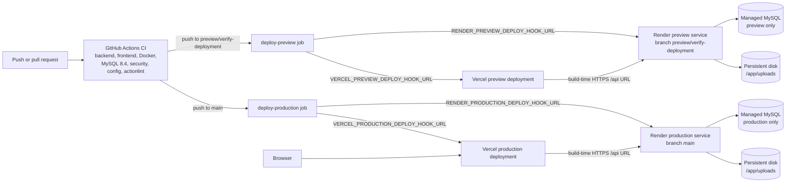

# AutoScientist AI 🔬

**An AI-powered data science platform that automates machine learning workflows, explains model predictions, evaluates fairness, and helps users explore datasets.**

AutoScientist AI is a full-stack application designed to simplify the data science lifecycle. It combines a React-based frontend with a Java Spring Boot backend to provide an integrated environment for data analysis, model experimentation, explainability, and reporting.

GitHub repository: `bharad1101/AutoScientist-AI` · Preview branch: `preview/verify-deployment` · Production branch: `main`

## ✨ Features

- **Automated Machine Learning (AutoML):** Streamline model experimentation and evaluation.
- **Data Analysis:** Explore datasets and generate statistical insights.
- **Explainable AI (XAI):** Help users understand model behavior and predictions.
- **Fairness Analysis:** Examine model performance across groups and identify potential disparities.
- **What-If Analysis:** Explore how changing input values may affect model outcomes.
- **Drift Monitoring:** Support analysis of changes in data distributions.
- **Ask Dataset:** Interact with dataset information through a question-and-answer interface.
- **Evidence Graph:** Connect analytical findings with supporting evidence.
- **Reports and PDF Export:** Present results in shareable report formats.
- **Workflow Navigation:** Organize analysis into structured stages.
- **Persistent Storage:** Support database-backed application data.
- **Responsive Interface:** Provide a browser-based interface for data science workflows.

## 🏗️ Technology Stack

| Component | Technologies |
|---|---|
| Backend | Java 17 (LTS, mandatory), Spring Boot 4 |
| Frontend | React 18, Vite |
| UI | Bootstrap 5 |
| Charts | Chart.js |
| Persistence | Managed MySQL 8.4 in deployed environments; H2 for local `dev`/`test` |
| Analytics | Java-based statistical and machine-learning engines |
| Build | Apache Maven 3.9.9 via the checked-in wrapper; npm |
| Deploy | GitHub Actions → Render (backend Docker services) + Vercel (frontend static site) |

## 🧩 Architecture



Two separate managed MySQL databases are mandatory: preview and production must never share a database. Both backend services require a durable disk mounted at `/app/uploads`; a `VOLUME` declaration in a Dockerfile does not provision provider storage. `frontend/vercel.json` declares Git deployment disabled for `main` and `preview/verify-deployment`, and `render.yaml` declares `autoDeployTrigger: off`; the provider dashboards must be checked to confirm these settings are actually active. GitHub Actions hooks are the authoritative deployment trigger for both release branches.

See [docs/ARCHITECTURE.md](docs/ARCHITECTURE.md) for the backend layering, request lifecycle, migrations, storage, and security model.

## 🚀 Getting Started

### Prerequisites

- **JDK 17 (required).** POM, CI, Docker images, and the Maven wrapper all target Java 17; Java 21+ is not supported. On macOS the local shell may default to Java 21, so select Java 17 explicitly before **any** Maven command:

  ```bash
  export JAVA_HOME="$(/usr/libexec/java_home -v 17)"
  export PATH="$JAVA_HOME/bin:$PATH"
  java -version          # must report 17.x
  ```

  On other platforms, set `JAVA_HOME` to a JDK 17 installation and prepend its `bin` directory to `PATH`.
- **Node.js and npm.** `frontend/package.json` declares `"engines": { "node": "^20.19.0 || ^22.13.0 || >=24.0.0" }`. CI pins Node **22.13.0**. The older claim that Node 22.12+ is required is wrong; Node 20.19+ and Node 22.13+ are both supported, as is Node 24+.
- Git.
- MySQL 8.0+ if you use the `mysql` profile; local `dev` uses file-backed H2.

### 1. Clone the repository

```bash
git clone https://github.com/bharad1101/AutoScientist-AI.git
cd AutoScientist-AI
```

### 2. Start the backend

```bash
export JAVA_HOME="$(/usr/libexec/java_home -v 17)"   # macOS; Java 17 is mandatory
export PATH="$JAVA_HOME/bin:$PATH"
cd backend
./mvnw spring-boot:run
```

Local development is the default (`dev`, file-backed H2). Production and preview use
`SPRING_PROFILES_ACTIVE=mysql` with a real datasource; the Docker images and
`render.yaml` set it explicitly, and the app refuses the `dev` profile on a hosted
runtime. `./scripts/run_backend.sh` additionally loads `backend/.env` when you
need local overrides. The backend is expected at `http://localhost:8080`.

`backend/mvnw` is the official Apache Maven Wrapper; it bootstraps Maven **3.9.9**
from `backend/.mvn/wrapper/maven-wrapper.properties`, which includes a
`distributionSha256Sum`. A separate Maven installation is not required.

### 3. Start the frontend

In a second terminal:

```bash
cd frontend
npm ci
npm run dev
```

Open the local frontend URL printed by Vite (commonly `http://localhost:5173`).
A local, gitignored `frontend/.env` may use `VITE_API_BASE_URL=/api`, so browser
calls go through Vite's dev proxy to `http://localhost:8080`. No `.env` file is
committed. An absolute localhost URL also works locally but bypasses that proxy
and requires backend CORS. Localhost values are rejected in deployed builds.

## 🧪 Testing

```bash
export JAVA_HOME="$(/usr/libexec/java_home -v 17)"   # macOS
export PATH="$JAVA_HOME/bin:$PATH"
cd backend && ./mvnw -B -ntp clean test
cd ../frontend && npm ci && npm test
```

CI additionally runs the production-configuration guards, packages the JAR and
asserts that Flyway migrations V1–V7 are in it, lints and audits the frontend,
builds both Docker images, runs real MySQL 8.4 migrations, scans secrets and
artifacts, scans dependencies with OSV, validates deployment configuration, and
validates the workflow with pinned actionlint. See
[.github/workflows/ci.yml](.github/workflows/ci.yml) and
[docs/GITHUB_RELEASE_GUIDE.md](docs/GITHUB_RELEASE_GUIDE.md).

## 🚢 Deployment overview

- **Check first, deploy second:** CI runs for pull requests targeting `main` or `preview/verify-deployment` and for pushes to those two branches. Deploy jobs run **only** on a push to `preview/verify-deployment` or `main`, and only after every check passes. If any check fails, no deploy hook is called.
- **Deploy hooks:** the jobs call the provider deploy-hook secrets
  `RENDER_PREVIEW_DEPLOY_HOOK_URL`, `VERCEL_PREVIEW_DEPLOY_HOOK_URL`,
  `RENDER_PRODUCTION_DEPLOY_HOOK_URL`, and `VERCEL_PRODUCTION_DEPLOY_HOOK_URL`.
  Health URLs come from repository variables
  `PREVIEW_BACKEND_HEALTH_URL`, `PREVIEW_FRONTEND_HEALTH_URL`,
  `PRODUCTION_BACKEND_HEALTH_URL`, and `PRODUCTION_FRONTEND_HEALTH_URL`.
  Deployment is additionally gated by `PREVIEW_DEPLOY_ENABLED` and
  `PRODUCTION_DEPLOY_ENABLED`. Only secret and variable **names** are documented
  here; no values are stored in the repository.
- **Backend:** `render.yaml` defines two Docker services pinned to
  `preview/verify-deployment` and `main`, with `healthCheckPath: /api/health/ready`,
  `autoDeployTrigger: off`, separate persistent disks at `/app/uploads`, and
  `sync: false` for secret values. Use two separate managed MySQL databases.
- **Frontend:** Vercel's Root Directory must be set to `frontend` in the
  dashboard. `frontend/vercel.json` declares framework `vite`, `npm ci`,
  `npm run build`, output `dist`, an SPA rewrite to `/index.html`, and
  `git.deploymentEnabled` set to `false` for `main` and
  `preview/verify-deployment`. Pull-request branches remain enabled so Vercel
  preview comments still work.
- **Build-time API URL:** for Production **and** Preview, `VITE_API_BASE_URL`
  must be an absolute HTTPS URL ending in `/api`, supplied in the provider build
  settings. Never use a localhost URL and never treat this variable as a secret.
  Same-origin `/api` is allowed only when a real reverse proxy exists and
  `VITE_API_PROXY_MODE=same-origin` is set. Vite bakes the value into `dist`, so
  changing it requires a rebuild.
- **Health:** backend liveness is `GET /api/health`; readiness is
  `GET /api/health/ready` (database + storage + Flyway state when enabled).
  Frontend health is the deployed root URL. Readiness data contains `status`,
  `database`, `storage`, `migrations`, and `timestamp` only. Sensitive actuator
  endpoints are rejected by the production guard; the dev profile exposes
  `health,metrics,prometheus` locally.
- **URL placeholders:** preview frontend `https://<preview-frontend-host>` and
  preview backend `https://<preview-backend-host>/api/health/ready`; production
  frontend `https://<production-frontend-host>` and production backend
  `https://<production-backend-host>/api/health/ready`. These are placeholders,
  not verified deployments.
- **Provider side is manual:** no real Render or Vercel deployment has been
  verified from this worktree. Confirm connected repository/branch, build
  settings, disks, databases, deploy hooks, health URLs, and auto-deploy flags in
  the provider dashboards before relying on a release.

Full procedures:
[GITHUB_RELEASE_GUIDE.md](docs/GITHUB_RELEASE_GUIDE.md),
[CI_CD_GUIDE.md](docs/CI_CD_GUIDE.md),
[VERCEL_SETUP.md](docs/VERCEL_SETUP.md),
[RENDER_SETUP.md](docs/RENDER_SETUP.md),
[MYSQL_SETUP.md](docs/MYSQL_SETUP.md),
[DEPLOYMENT_TROUBLESHOOTING.md](docs/DEPLOYMENT_TROUBLESHOOTING.md),
and [ROLLBACK_GUIDE.md](docs/ROLLBACK_GUIDE.md).

### Backend provider environment variable names

Set these in the provider (names only; never commit values):
`SPRING_PROFILES_ACTIVE`, `SPRING_DATASOURCE_URL`, `SPRING_DATASOURCE_USERNAME`,
`SPRING_DATASOURCE_PASSWORD`, `JWT_SECRET`, `APP_CORS_ALLOWED_ORIGINS`,
`FRONTEND_URL`, `FILE_UPLOAD_DIR`, `SPRING_JPA_HIBERNATE_DDL_AUTO`,
`SPRING_FLYWAY_ENABLED`, `RATE_LIMIT_ENABLED`, `ALLOW_PROXY_HEADERS`,
`FORWARD_HEADERS_STRATEGY`, `TRUSTED_PROXY_COUNT`, plus optional SMTP and
password-reset settings (`SPRING_MAIL_HOST`, `SPRING_MAIL_PORT`,
`SPRING_MAIL_USERNAME`, `SPRING_MAIL_PASSWORD`, `PASSWORD_RESET_FROM`,
`PASSWORD_RESET_TTL_MINUTES`, `PASSWORD_RESET_MIN_INTERVAL_SECONDS`).

### Staging, commit and push

The exact file-by-file staging plan, commit message, and push command are in
[docs/GITHUB_RELEASE_GUIDE.md](docs/GITHUB_RELEASE_GUIDE.md).
Never use `git add .` or `git add -A` while ignored local secrets, data, build
output, or database files are present: ignored `.env` files, `uploads/`,
`backups/`, `target/`, `dist/`, `node_modules/`, and `*.mv.db` remain local and
must not be staged.

## 🔐 Configuration

Configure database connections and other environment-specific settings through
provider secret settings or gitignored local `.env` files. See
[docs/DEPLOYMENT.md](docs/DEPLOYMENT.md) §2 for the full reference.

**Security recommendations:**

- Do not commit production passwords, API keys, tokens, or other secrets. The
  `dev` profile generates a local-only signing secret; no dev secret is packaged
  in `backend/src/main/resources/application-dev.yml`, and hosted runtimes
  refuse that profile.
- Keep local environment files and generated artifacts out of version control.
  Ignored local secrets/data/artifacts remain local and must not be staged.
- Use separate database credentials for preview and production.
- JWTs are signed with HS256. `JWT_SECRET` must be Base64-encoded and decode to
  at least 32 bytes (64 random bytes recommended for production); rotating it
  invalidates existing tokens.
- Review the repository before making it public.

## 🗺️ Project Roadmap

Potential future improvements include:

- Expanded model selection and evaluation methods
- More interactive visualizations
- Additional explainability techniques
- Enhanced dataset validation and monitoring
- Improved documentation and deployment options

## 🤝 Contributing

Contributions, bug reports, and feature suggestions are welcome.

1. Fork the repository.
2. Create a feature branch.
3. Make and test your changes with Java 17 and a supported Node version.
4. Submit a pull request describing your contribution.

## 📄 License

This project is licensed under the MIT License. See the [LICENSE](LICENSE) file for details.

## 👨‍💻 Author

**Contributors:** Pola Bharadwaj and Kola Rajesh

GitHub: [@bharad1101](https://github.com/bharad1101)

---

*Built to make data science workflows more accessible, explainable, and reproducible.*
