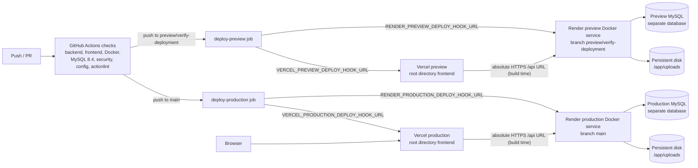

# Architecture — AutoScientist AI

## 1. Overview

AutoScientist AI is a two-tier application:

- **Frontend** — React 18 + Vite SPA (Bootstrap 5 CSS, Chart.js). Talks to the
  backend over HTTPS at a build-time configured base URL ending in `/api`.
  Node engines are `^20.19.0 || ^22.13.0 || >=24.0.0`; CI pins 22.13.0.
- **Backend** — Spring Boot 4 on **Java 17** exposing a stateless JWT REST API,
  performing real statistical/ML analysis, and persisting data in managed MySQL
  (H2 for local dev/test). Java 17 is mandatory in POM, CI, Docker, and wrapper.

```text
Browser (React SPA, dist/)
        │  HTTPS + Bearer JWT
        ▼
┌─────────────────────────────────────────────────────────────┐
│ Spring Boot backend                                          │
│  servlet filters: RequestId → RateLimit → AuthToken → …      │
│  controllers (/api/**) → services → analysis engines         │
│  JPA repositories → MySQL; local filesystem storage only     │
│  JobExecutorService (bounded pool) → same services           │
└─────────────────────────────────────────────────────────────┘
        │                                   │
        ▼                                   ▼
   Managed MySQL 8.4+                 Durable disk /app/uploads
   (Flyway V1–V7)                     (FILE_UPLOAD_DIR)
```

### Deployment topology



`render.yaml` pins the two backend services to their branches, sets
`healthCheckPath: /api/health/ready`, `autoDeployTrigger: off`, and separate
disks. Provider Git auto-deploy is disabled for `main` and
`preview/verify-deployment` so CI deploy hooks are the only trigger for those
branches; PR branches remain enabled in Vercel for preview comments. Two
separate managed MySQL databases are mandatory. No real provider deployment has
been verified from this worktree; provider settings require manual checks.

## 2. Backend layering

| Layer | Package | Responsibility |
|---|---|---|
| Filters | `security/` | Request/correlation ID, rate limiting, JWT authentication, headers |
| Controllers | `controller/` | HTTP mapping, request validation, auth principal, `ApiResponse` |
| Services | `service/` | Transactions, ownership checks, orchestration, jobs, reports, serving |
| Analysis engines | `analysis/**` | Profiling, EDA, statistics, associations, quality, ML, XAI, fairness, drift, findings, reports |
| Repositories | `repository/` | Spring Data JPA, owner-scoped queries |
| Entities / DTOs | `entity/`, `dto/` | Persistence model and API contracts |
| Utilities | `util/` | CSV/Excel parsing, storage, column selection, artifacts |
| Config | `config/` | Security, CORS, resource budgets, storage, rate limits |

Analysis engines are plain, testable classes. Heavy request work is synchronous;
optional long-running analysis can be submitted as a background job.

## 3. Request lifecycle

1. `RequestIdFilter` assigns/reuses a safe `X-Request-Id`, puts it in MDC, and
   clears MDC in `finally`.
2. `RateLimitingFilter` applies a per-user/IP token bucket and returns `429` +
   `Retry-After` when exhausted (health/actuator/OPTIONS exempt).
3. `AuthTokenFilter` validates the Bearer JWT and populates the security context.
4. The controller validates input, resolves the current user, and calls a service.
5. Services enforce ownership (foreign resources return `404`) and delegate
   computation to analysis engines.
6. Responses use `ApiResponse {success,message,data,timestamp}` unless streaming
   a file (PDF/CSV/Excel/Markdown). Errors are mapped by `GlobalExceptionHandler`
   (validation → 400, auth → 401/403, missing → 404, size/limits → 413,
   conflict → 409, unexpected → 500 without leaking internals).

## 4. Persistence and migrations

- Flyway owns the schema in the `mysql` profile; Hibernate runs with
  `SPRING_JPA_HIBERNATE_DDL_AUTO=validate`.
- Migration chain: `V1` baseline (17 tables, **immutable**), `V2` provenance,
  `V3` association CIs, `V4` password reset tokens, `V5` jobs + model artifacts
  (portable), `V6` MySQL `LONGBLOB` widening, `V7` idempotent job ownership.
- Final schema: 20 tables (`users`, `datasets`, `dataset_columns`,
  `data_quality_reports`, `data_quality_issues`, `associations`,
  `research_questions`, `hypotheses`, `statistical_tests`, `experiments`,
  `experiment_versions`, `models`, `findings`, `evidence_nodes`, `reports`,
  `analysis_runs`, `drift_snapshots`, `password_reset_tokens`, `jobs`,
  `model_artifacts`).
- `database/schema.sql` is a human-readable reference kept in sync by
  `SchemaReferenceSyncTest`. CI runs the migrations against real MySQL 8.4.

## 5. Storage

- Storage is local filesystem only: `StorageConfig` creates a single
  `LocalStorageBackend` under `app.upload.dir`; no S3 backend exists.
- Uploads are validated (extension, size, rows, columns), stored under a
  UUID-generated name (no user-controlled paths), and served only to the owner.
- `GET /api/health/ready` verifies both the datasource and storage; its payload
  contains `status`, `database`, `storage`, and `timestamp` (no `storageBackend`).
- A persistent provider disk at `/app/uploads` is mandatory in preview and
  production. A Dockerfile `VOLUME` declaration does not provision one;
  ephemeral filesystems lose uploads across redeploys.

## 6. Background jobs

- `JobExecutorService` owns a bounded `ThreadPoolExecutor`; submissions beyond
  the queue fail explicitly with `413`.
- Jobs persist `type`, `owner`, `datasetId`, `targetColumn`, `problemType`,
  `status`, `progress`, timestamps, and error text.
- Supported: `EDA`, `ASSOCIATION`, `AUTOML` (target required). `INGESTION` is
  rejected with guidance to upload synchronously.
- Lifecycle: interrupted `RUNNING` jobs are failed on startup; TTL cleanup
  removes stale records; cancellation is best effort; queue-full is never
  reported as success.
- Metrics: `autoscientist.jobs.submitted|completed|failed|canceled|rejected`
  counters and `tracked|queued|active` gauges.

## 7. ML and model serving

- Training benchmarks candidate models and persists the best one as a
  `ServingArtifact`: model, feature names, preprocessing, reverse class map,
  target, problem type, algorithm.
- Artifacts are gzip-compressed Java serialization read back through an
  `ObjectInputFilter` allowlist (depth/reference/array limits) to prevent
  gadget-style deserialization.
- `POST /api/v1/models/{id}/predict` replays preprocessing and performs real
  inference. Unsupported operations return explicit errors — there are no fake
  predictions or fabricated metrics.

## 8. Security model

- Stateless JWT (HS256), BCrypt passwords, single-use SHA-256 password-reset
  tokens with expiry.
- Exact-origin CORS allowlist; no wildcard with credentials.
- Security headers: frame options, content-type options, XSS protection, HSTS.
- `/actuator/info` is intentionally **not public**: dev-style `info.env`
  settings could otherwise expose environment data. Base actuator exposure is
  `health,metrics,prometheus` only. Use `/api/health` and `/api/health/ready`
  for deployment verification.
- The `dev` profile is refused when combined with `mysql`, a hosted-runtime
  marker, or a non-H2 datasource; deployed services use `SPRING_PROFILES_ACTIVE=mysql`.
- Secrets are provider-secret/environment supplied; none are committed. Ignored
  local secrets/data/artifacts remain local and must not be staged.

## 9. Observability

- Liveness: `GET /api/health`. Readiness: `GET /api/health/ready` (DB + storage,
  HTTP 503 when not ready). Frontend health is the deployed root URL.
- Micrometer + Prometheus metrics; job counters/gauges.
- Request IDs in responses and logs; job lifecycle logs carry job id/type.
- Errors are logged without exposing secrets or stack traces to clients.

## 10. Deployment topology and constraints

- Backend container builds with Maven 3.9.9 on `eclipse-temurin:17-jre-jammy`
  runtime, non-root uid 10001; the entrypoint validates the upload directory
  before starting the JVM. The wrapper pins Maven 3.9.9 with a checksum.
- Matched Docker pairs only: root context `.` + root `Dockerfile`, or `backend`
  context + `backend/Dockerfile`. Both declare `VOLUME ["/app/uploads"]`.
- Frontend is a static `dist/` bundle with an SPA fallback. Vercel Root
  Directory `frontend` is a dashboard setting; `frontend/vercel.json` declares
  framework `vite`, `npm ci`, `npm run build`, `dist`, SPA rewrite, and disables
  Git deploys for `main` and `preview/verify-deployment` (PR branches remain on).
  Separate deployments require an absolute HTTPS `VITE_API_BASE_URL` ending in
  `/api` for Production and Preview; a same-origin `/api` path is accepted only
  with `VITE_API_PROXY_MODE=same-origin` and a real reverse proxy. The build
  guard rejects missing, loopback, credentialed, query/fragment, non-standard
  port, and trailing-slash values.
- CI runs backend tests/guards, frontend lint/tests/audit/build/no-local API
  check, Docker builds, real MySQL 8.4 migrations, secret/artifact and OSV
  scans, deployment-config validation, and pinned actionlint validation on PRs
  and pushes. Deploy jobs run only on a push to the correct branch, after all
  checks pass, via provider deploy-hook secrets; health URLs are repository
  variables. Provider auto-deploy is off for those branches to prevent duplicate
  deployments.
- Known constraints: rate limiting is per-instance (needs a shared store to
  scale horizontally); CSV parsing is bounded in memory rather than fully
  streaming; durable storage is required for uploads.
