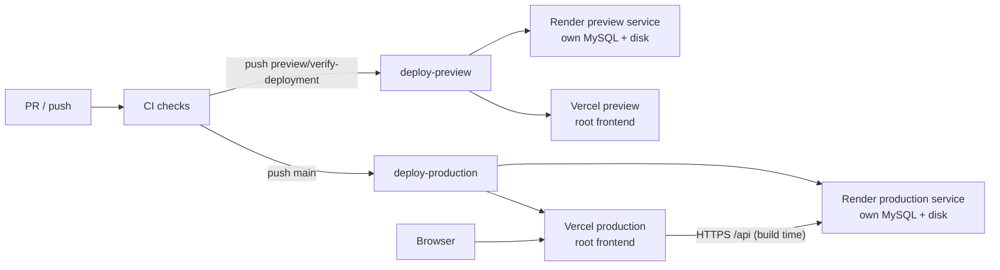

# AutoScientist AI — Deployment Guide

> **Canonical settings:** source-verified configuration and release gates are
> collected in `release-readiness/CANONICAL_DEPLOYMENT_CHECKLIST.md`. Provider
> values shown here are examples or placeholders; actual Render/Vercel settings,
> databases, hooks, and health URLs must be checked manually in the dashboards.
> No real provider deployment has been verified from this worktree.

## 1. System Requirements & Architecture

- **Operating System**: Linux (Ubuntu 22.04 LTS / Debian 12 / RHEL 9), macOS, Windows WSL2.
- **Java**: JDK **17** (OpenJDK / Eclipse Temurin) is mandatory for build and
  runtime. POM (`java.version` and `maven.compiler.release`), CI, Docker images,
  and the Maven wrapper all target 17; Java 21+ is not supported. On macOS the
  shell may default to Java 21, so select 17 before Maven commands:

  ```bash
  export JAVA_HOME="$(/usr/libexec/java_home -v 17)"
  export PATH="$JAVA_HOME/bin:$PATH"
  java -version
  ```

- **Node.js**: `frontend/package.json` engines are
  `^20.19.0 || ^22.13.0 || >=24.0.0`; CI pins **22.13.0**. The old "22.12+" claim
  is wrong.
- **Database**: MySQL 8.0+ (CI uses 8.4) for deployed services, file-backed H2
  for local `dev`, in-memory H2 for `test`. **Two separate managed databases**
  are mandatory: one for preview, one for production.
- **Memory**: Minimum 2 GB RAM (4 GB recommended for large ML models).
- **Disk**: 1 GB free locally; each deployed backend needs a persistent provider
  disk mounted at `/app/uploads`.



---

## 2. Environment Variables Configuration

Create `.env` in `backend/` and `frontend/` from the templates when running
locally; use provider secret settings for deployed services. Never commit values.
Ignored local `.env` files, `uploads/`, `backups/`, `target/`, `dist/`,
`node_modules/`, and `*.mv.db` remain local and must not be staged.

### Backend Configuration (`backend/.env`)

```bash
# Server Port
PORT=8080

# Staging/production must use MySQL. The dev profile is local-only.
SPRING_PROFILES_ACTIVE=mysql

# Database Configuration — REQUIRED for the mysql profile (no defaults).
# Each deployed service has its own managed database. REQUIRED encrypts traffic;
# use VERIFY_CA/VERIFY_IDENTITY when a provider CA is configured.
SPRING_DATASOURCE_URL=jdbc:mysql://<db-host>:<port>/<database>?sslMode=REQUIRED&serverTimezone=UTC
SPRING_DATASOURCE_USERNAME=<application-user>
SPRING_DATASOURCE_PASSWORD=<from-secret-manager>

# JWT Security Secret — REQUIRED for the mysql profile (no default; startup fails fast).
# Must be base64 with NO line breaks. Generate a fresh key per environment:
#   openssl rand -base64 64 | tr -d '\n'
# HS256; the code enforces >= 32 decoded bytes; 64 random bytes are recommended.
JWT_SECRET=<generated-base64-secret>
JWT_EXPIRATION_MS=86400000

# File Upload Storage Directory (wired to app.upload.dir)
FILE_UPLOAD_DIR=/app/uploads/datasets

# Bounded upload/resource limits (defaults shown)
UPLOAD_MAX_FILE_SIZE=50MB
UPLOAD_MAX_REQUEST_SIZE=50MB
RESOURCE_BUDGET_MAX_MB=50
RESOURCE_BUDGET_MAX_ROWS=1000000
RESOURCE_BUDGET_MAX_COLUMNS=5000
RESOURCE_BUDGET_MAX_CELLS=10000000
RESOURCE_BUDGET_MAX_SHEETS=20

# Deployment/proxy/runtime switches set by render.yaml
SPRING_JPA_HIBERNATE_DDL_AUTO=validate
SPRING_FLYWAY_ENABLED=true
RATE_LIMIT_ENABLED=true
ALLOW_PROXY_HEADERS=true
FORWARD_HEADERS_STRATEGY=framework
TRUSTED_PROXY_COUNT=1

# Password reset (link base URL must be the public frontend origin)
FRONTEND_URL=https://<your-frontend-host>
APP_CORS_ALLOWED_ORIGINS=https://<your-frontend-host>
PASSWORD_RESET_FROM=no-reply@yourdomain.com
PASSWORD_RESET_TTL_MINUTES=30
PASSWORD_RESET_MIN_INTERVAL_SECONDS=60

# SMTP delivery for reset emails. Without SMTP, forgot-password cannot deliver
# a link in production (the dev outbox is local-only).
SPRING_MAIL_HOST=smtp.yourdomain.com
SPRING_MAIL_PORT=587
SPRING_MAIL_USERNAME=<smtp-username>
SPRING_MAIL_PASSWORD=<from-secret-manager>
SPRING_MAIL_PROPERTIES_MAIL_SMTP_AUTH=true
SPRING_MAIL_PROPERTIES_MAIL_SMTP_STARTTLS_ENABLE=true
```

> The `mysql` profile refuses to start if `SPRING_DATASOURCE_URL`,
> `SPRING_DATASOURCE_USERNAME`, `SPRING_DATASOURCE_PASSWORD`, `JWT_SECRET`,
> `APP_CORS_ALLOWED_ORIGINS`, or `FRONTEND_URL` is missing. A local source
> checkout defaults to `dev` and requires `APP_ENVIRONMENT=local` (or
> `app.environment=local`) at startup; Docker forces `mysql`; hosted runtimes
> refuse `dev`. No secret values belong in the repository.

### Frontend Configuration (`frontend/.env`)

```bash
# LOCAL DEVELOPMENT: use the Vite dev proxy to http://localhost:8080.
VITE_API_BASE_URL=/api

# PRODUCTION and PREVIEW, separate deployments (set in provider build settings):
# VITE_API_BASE_URL=https://<backend-origin>/api

# PRODUCTION/PREVIEW, same-origin reverse proxy that really routes /api to backend:
# VITE_API_BASE_URL=/api
# VITE_API_PROXY_MODE=same-origin
```

> Every Vite build fails fast if the value is missing, invalid, non-HTTPS,
> localhost/loopback (including mapped IPv6 and numeric encodings), credentialed,
> query/fragment-bearing, non-standard-port, or missing the `/api` suffix. Bare
> `/api` is rejected unless `VITE_API_PROXY_MODE=same-origin` is set explicitly.
> `VITE_API_BASE_URL` is embedded at build time, so changing it requires a
> rebuild. Never a localhost URL and never a secret. The real production URL is
> supplied by an operator, not recorded in this repository.

---

## 3. Database Initialization

Create/select one application database and a migration-capable least-privilege
user **per environment** (preview and production are separate). Keep credentials
out of Git. Do not run `database/schema.sql` or a root-user initialization
procedure against a deployed database; Flyway applies versioned migrations on
startup.

### 3.1 Schema strategy & migrations

- `mysql` profile: Flyway enabled (`baseline-on-migrate=true`,
  `baseline-version=1`, `validate-on-migrate=true`), then Hibernate
  `SPRING_JPA_HIBERNATE_DDL_AUTO=validate`.
- `dev`: local file-backed H2 with Hibernate `update`; `test`: in-memory H2 with
  `create-drop`. Flyway is disabled for both.
- Migrations: `V1__baseline.sql` (17 tables, immutable), `V2__provenance_delta.sql`,
  `V3__association_confidence_intervals.sql`, `V4__password_reset_tokens.sql`,
  `V5__jobs_and_model_artifacts.sql`, `V6__model_artifact_longblob.sql`,
  `V7__job_ownership_and_parameters.sql`. Never edit an applied migration; add a
  new version. Pre-Flyway databases are baselined at V1 and receive V2–V7.
- CI runs these against disposable real MySQL 8.4 before any deploy job can run.
- `database/schema.sql` is the human-readable reference kept in sync by
  `SchemaReferenceSyncTest`.

### 3.2 Durable file storage

Uploads are stored under `app.upload.dir` (`FILE_UPLOAD_DIR`,
`/app/uploads/datasets` in the container) with UUID filenames. Local filesystem
storage is not durable on its own: a persistent provider disk must be mounted at
`/app/uploads` for each backend service. Without it, database metadata points to
missing files and the API reports an explicit missing-file error. Ephemeral
container storage is not acceptable for deployed services. In-memory caches are
process-local and rebuilt on demand.

### 3.3 Backup & recovery

Before any deployment or migration, take a logical backup; store it outside the
repository with restricted permissions (backups may contain user data and
password hashes):

```bash
mysqldump -u <user> -p --single-transaction --routines <database> \
  > backups/<database>_$(date +%Y%m%d_%H%M%S).sql
tar -czf backups/uploads_$(date +%Y%m%d_%H%M%S).tar.gz uploads/
```

Restore the dump and the upload directory together so metadata and files stay in
sync. Migrations are additive-only; rollback is restore + redeploy previous JAR,
never an edit to an applied migration.

---

## 4. Production Build & Packaging

Select Java 17 first (macOS: `export JAVA_HOME="$(/usr/libexec/java_home -v 17)"`).
The wrapper pins Maven 3.9.9 with a `distributionSha256Sum`.

```bash
cd backend
./mvnw -B -ntp clean package
# backend/target/autoscientist-backend-1.0.0-SNAPSHOT.jar

cd ../frontend
npm ci
VITE_API_BASE_URL=https://<backend-origin>/api npm run build
# frontend/dist/
```

CI asserts the packaged JAR contains Flyway V1–V7 and that the built bundle has
no local API URL. Set the build-time URL in the provider for Production and
Preview instead of relying on a shell.

---

## 5. Running the Application

```bash
./scripts/run_backend.sh        # loads backend/.env, local dev by default
# or
SPRING_PROFILES_ACTIVE=mysql java -jar backend/target/autoscientist-backend-1.0.0-SNAPSHOT.jar

./scripts/run_frontend.sh       # Vite dev server
# or serve frontend/dist/ with a static server / Nginx for production
```

---

## 6. Nginx Reverse Proxy Production Setup (optional)

```nginx
server {
    listen 80;
    server_name autoscientist.yourdomain.com;

    location / {
        root /path/to/frontend/dist;
        try_files $uri $uri/ /index.html;
    }

    location /api/ {
        proxy_pass http://127.0.0.1:8080/api/;
        proxy_set_header Host $host;
        proxy_set_header X-Real-IP $remote_addr;
        proxy_set_header X-Forwarded-For $proxy_add_x_forwarded_for;
        proxy_set_header X-Forwarded-Proto $scheme;
    }
}
```

With this topology, build with `VITE_API_BASE_URL=/api` and
`VITE_API_PROXY_MODE=same-origin`. Do not use same-origin mode with the Vercel
SPA rewrite in `frontend/vercel.json`; it does not proxy `/api`.

---

## 7. CORS Configuration

The backend accepts browser requests only from exact origins in
`APP_CORS_ALLOWED_ORIGINS` (comma-separated); the local dev defaults are not
appropriate for deployed frontends. Set it and `FRONTEND_URL` to the exact public
frontend origin(s) for each environment. With the Nginx same-origin topology the
origin matches automatically.

---

## 8. GitHub Actions CI and gated deploys

CI (`.github/workflows/ci.yml`) runs on pull requests and pushes to `main` and
`preview/**`:

- Backend tests + `DeploymentProfileGuardTest` + package/JAR migration assertion (Java 17).
- Frontend `npm ci`, lint, tests, `npm audit`, production build, and no-local-API check (Node 22.13.0).
- Both Docker image builds.
- Real MySQL 8.4 migration and runtime smoke tests.
- Secret/artifact scan, OSV scan, deployment-config validation
  (`scripts/validate-deployment-config.sh`), and pinned actionlint workflow validation.

Deploy jobs run **only on push** to the correct branch, after **all** checks
pass, and only when the corresponding repository variable is `true`:

- `deploy-preview`: `preview/verify-deployment`, `PREVIEW_DEPLOY_ENABLED`,
  secrets `RENDER_PREVIEW_DEPLOY_HOOK_URL` / `VERCEL_PREVIEW_DEPLOY_HOOK_URL`,
  variables `PREVIEW_BACKEND_HEALTH_URL` / `PREVIEW_FRONTEND_HEALTH_URL`.
- `deploy-production`: `main`, `PRODUCTION_DEPLOY_ENABLED`, secrets
  `RENDER_PRODUCTION_DEPLOY_HOOK_URL` / `VERCEL_PRODUCTION_DEPLOY_HOOK_URL`,
  variables `PRODUCTION_BACKEND_HEALTH_URL` / `PRODUCTION_FRONTEND_HEALTH_URL`.

A failed check prevents the hooks from being called. Provider Git auto-deploy
must be off for `main` and `preview/verify-deployment` to avoid duplicate
deployments; Vercel pull-request branches remain enabled for preview comments.
Vercel Root Directory must be `frontend` (dashboard setting); `frontend/vercel.json`
declares framework `vite`, `npm ci`, `npm run build`, `dist`, the SPA rewrite,
and disables Git-triggered deploys for `main` and `preview/verify-deployment`.

`render.yaml` declares two Docker services: preview on
`preview/verify-deployment` and production on `main`, both with
`healthCheckPath: /api/health/ready`, `autoDeployTrigger: off`, separate disks at
`/app/uploads`, and `sync: false` for secret values. Use separate managed MySQL
databases; never share credentials between environments.

---

## 9. Post-Deploy Verification (smoke test)

The public health endpoints are `GET /api/health` (liveness) and
`GET /api/health/ready` (readiness; database + storage). Frontend health is the
deployed root URL. `/actuator/info` is intentionally not public; the base config
exposes `health,metrics,prometheus` only, so use `/api/health*`.

```bash
BASE=https://<backend-origin>/api     # from the health URL repository variable

curl -fsS "$BASE/health"                         # data.status UP
curl -fsS "$BASE/health/ready"                   # data.status/database/storage/timestamp
curl -s -o /dev/null -w '%{http_code}\n' "$BASE/datasets"   # expect 401, not 500

TOKEN=$(curl -s -X POST "$BASE/auth/register" -H 'Content-Type: application/json' \
  -d '{"name":"smoke","email":"smoke@<your-domain>","password":"Pass1234!"}' \
  | python3 -c 'import sys,json;print(json.load(sys.stdin)["data"]["token"])')
curl -s -o /dev/null -w '%{http_code}\n' -H "Authorization: Bearer $TOKEN" "$BASE/dashboard/stats"
```

Readiness data contains `status`, `database`, `storage`, and `timestamp` only —
there is no `storageBackend` field. A healthy flow returns 401, then a JWT, then
200. If step 1 returns 500, check the database and `JWT_SECRET` configuration.
After migration, confirm `flyway_schema_history` contains V1–V7.

---

## 10. Preview and production runbooks

**Preview:** push reviewed changes to `preview/verify-deployment` → all CI checks
pass → `deploy-preview` calls both preview hooks and polls the preview health
URLs → verify the preview Render service uses its own MySQL database and
persistent disk, Vercel Preview uses `frontend` as root with a real HTTPS
`/api` base URL → run §9 with throwaway data.

**Production:** promote only commits already green on preview via PR to `main` →
all CI checks pass → push/merge to `main` → `deploy-production` calls both
production hooks and polls production health URLs → verify the production
service branch, separate database, disk `/app/uploads`, health path, hook
targets, auto-deploy off, and Vercel Production/Preview build-time API URLs →
run §9 with a throwaway account.

Exact commands (documented only, not run here):

```bash
git status --short
git diff --check
git add README.md DEPLOYMENT_GUIDE.md docs/DEPLOYMENT.md docs/ARCHITECTURE.md docs/TROUBLESHOOTING.md release-readiness/CANONICAL_DEPLOYMENT_CHECKLIST.md release-readiness/FINAL_RELEASE_REPORT.md
git diff --cached --check
git commit -m "docs: align deployment guidance with CI-gated deploys"
git push origin preview/verify-deployment
```

Stage full release-candidate changes explicitly (including untracked
`.github/workflows/ci.yml`, `render.yaml`, and wrapper files); never `git add -A`
while ignored secrets/data/artifacts are present. No real provider deployment
has been verified from this worktree — check provider settings manually.

Troubleshooting: [docs/TROUBLESHOOTING.md](TROUBLESHOOTING.md).
